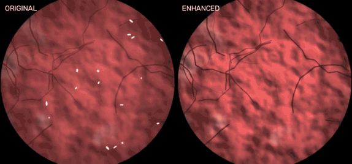
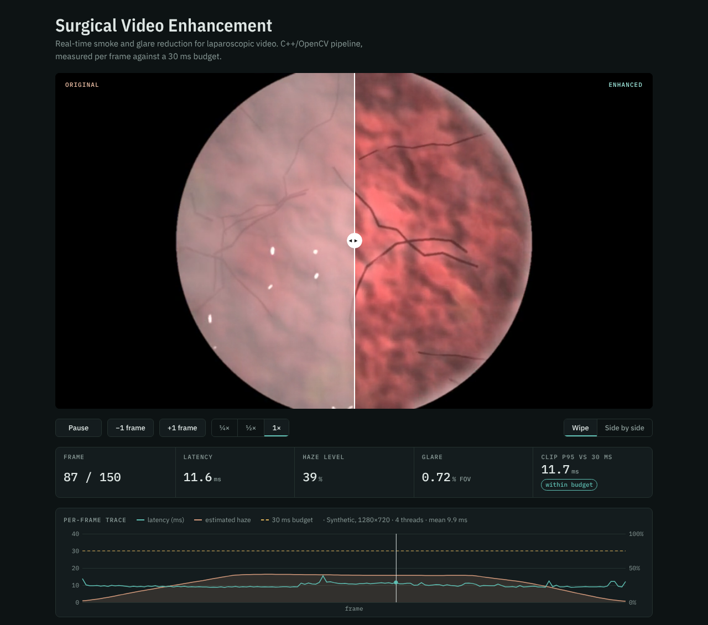
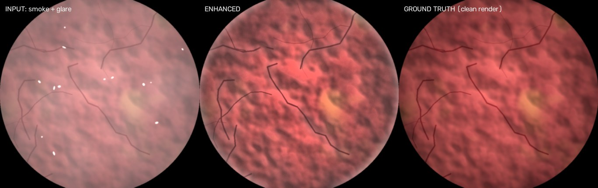

# Surgical Video Enhancement

[](https://github.com/hareemakram/surgical-video-enhancement/actions/workflows/ci.yml)

Real-time enhancement of laparoscopic / endoscopic video in C++17 and OpenCV. It reduces
**surgical smoke** and **specular glare** and boosts local contrast, within a **30 ms per-frame
budget**, without shifting tissue colour. A Python test suite verifies image quality against
ground truth and checks latency. Requirements trace to tests, and CI publishes a verification
report on every push.

> Engineering portfolio project. Not a medical device and not for clinical use.



Full-quality clips: [original](demo/media/synthetic_before.mp4) · [enhanced](demo/media/synthetic_after.mp4).
The interactive viewer (below) plays them with a draggable wipe and a per-frame latency trace.



## Results

All 15 requirements pass (32 tests). Measured on a 4 vCPU cloud VM with OpenCV 4.6:

| | Input | Enhanced |
|---|---|---|
| Heavy smoke, colour error to ground truth (ΔE00, lower is better) | 22.1 | **5.8** |
| Heavy smoke, PSNR to ground truth | 15.7 dB | **25.4 dB** |
| Glare pixels remaining in highlight regions | 79 % | **0 %** |
| Hue shift vs ground truth (full pipeline) | | **1.3°–2.6°** (limit 5°) |
| Clear footage, change from smoke removal (ΔE00) | | **0.95** (limit 2.0) |
| Latency 1280×720, mean / p95 | | **8.2 / 10.2 ms** |
| Latency 1920×1080, mean / p95 | | **19.1 / 23.5 ms** |



Full evidence is in [docs/traceability.md](docs/traceability.md).

## How it works

```
BGR frame ─► FOV maps ─► glare detect (full res) ─► glare in-fill (¼ res)
                                                       │
           dark channel + neutral airlight + tissue floor + guided filter (¼ res)
                                                       │
           fused full-res pass: FOV test, glare blend, haze inversion
                                                       │
           CLAHE on luminance, applied as a hue-preserving gain ─► output
```

* **Smoke**: dark channel prior (He et al.) adapted for tissue. The airlight is forced neutral,
  since smoke scatters white scope light, and a "tissue floor" stops red tissue being read as haze,
  so clear frames pass through unchanged. The airlight is smoothed over time to prevent flicker.
* **Glare**: bright and colourless pixels are filled from surrounding tissue by normalized
  convolution, which has a fixed run time unlike inpainting. Over-exposed frames are left alone.
* **Speed**: all estimation runs at ¼ resolution. Results are applied in one multi-threaded
  full-resolution pass that samples the low-resolution maps directly. The first prototype took
  70–110 ms per 720p frame.
* **Safety**: never throws, passes invalid frames through unchanged and flags them, never touches
  pixels outside the scope image, and is deterministic.

Details: [design](docs/design.md) · [requirements](docs/requirements.md) ·
[verification plan](docs/verification-plan.md).

## Build and run

Ubuntu 24.04 (other platforms work with OpenCV 4 and CMake):

```bash
sudo apt-get install -y libopencv-dev cmake g++ ffmpeg
cmake -S . -B build -DCMAKE_BUILD_TYPE=Release && cmake --build build -j

# Enhance a video (or a directory of PNGs) and write a per-frame latency report
./build/sve_cli --input in.mp4 --output out.mp4 --report report.json
./build/sve_cli --input in.mp4 --output compare.mp4 --side-by-side
```

Options: `--no-glare`, `--no-dehaze`, `--no-contrast`, `--omega`, `--dark-floor`,
`--clahe-clip`, `--threads`, `--repeat`, `--warmup`. Run `sve_cli --help` for the full list.

## Tests and reports

```bash
pip install -r requirements-test.txt
python -m pytest --junitxml=reports/junit.xml --html=reports/test-report.html --self-contained-html
python tools/trace_report.py --junit reports/junit.xml --out reports/traceability.md
```

Tests render synthetic laparoscopy footage with exact ground truth (`tools/synth.py`), run the
real `sve_cli` binary, and score the output. Each test is tagged with the requirement it verifies
(`@pytest.mark.req("REQ-FUN-001")`). CI ([.github/workflows/ci.yml](.github/workflows/ci.yml))
builds with `-Werror`, runs the suite, posts the traceability matrix to the job summary and
uploads the HTML report, JUnit XML and benchmark as artifacts. CI fails if any requirement is not
verified.

## Demo viewer

`demo/index.html` compares before and after with a draggable wipe or side by side, with the
per-frame latency and haze estimate synced to the playhead.

```bash
python tools/make_demo.py                              # synthetic cautery-smoke clip
scripts/fetch_sample.sh && python tools/make_demo.py   # also the real CC BY clip
python -m http.server -d demo 8000                     # open http://localhost:8000
```

## Footage and credits

Real footage: laparoscopic cholecystectomy video from Boer, Boerma & de Vries Reilingh,
*J Med Case Reports* 5:588 (2011), [CC BY 2.0](https://creativecommons.org/licenses/by/2.0/), via
Wikimedia Commons. It is downloaded by `scripts/fetch_sample.sh`, not committed, and used only for
the demo. See [ATTRIBUTION.md](ATTRIBUTION.md). All other footage is synthetic.

## Limitations

* The airlight is global. Scope light falls off toward the rim, so heavy smoke there is
  under-corrected.
* Parameters were tuned on synthetic data. Real footage has been checked visually only.
* Latency is measured on CPU, for the processing step only. A product would verify
  glass-to-glass latency on its target hardware.

## Author

Hareem Akram ([@hareemakram](https://github.com/hareemakram))

## License

MIT, see [LICENSE](LICENSE). Footage licenses in [ATTRIBUTION.md](ATTRIBUTION.md).
