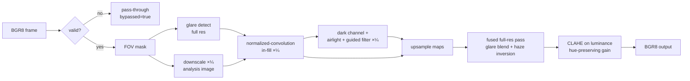

# Software Design Description

| | |
|---|---|
| Document | SDD-SVE-001 |
| Implements | [SRS-SVE-001](requirements.md) |

## 1. Architecture

SVE is a C++17 static library (`libsve`, namespace `sve`) with one public class, `sve::Pipeline`,
plus a command-line front end (`sve_cli`) used for batch processing, benchmarking and verification.
The Python test suite drives `sve_cli` as a black box, so the code under test is exactly the
shipped binary.

| Component | File | Requirements |
|---|---|---|
| `Pipeline::process` (validation, fail-safe, timing) | `src/pipeline.cpp` | REQ-SAF-001, REQ-FUN-005, REQ-IF-002 |
| `detect_fov` | `src/stages.cpp` | REQ-SAF-002 |
| `detect_glare`, `glare_fill` | `src/stages.cpp` | REQ-FUN-002 |
| Dehaze (in `process_impl`), `guided_filter` | `src/pipeline.cpp`, `src/stages.cpp` | REQ-FUN-001, REQ-FUN-004, REQ-PRF-003 |
| Contrast (in `process_impl`) | `src/pipeline.cpp` | REQ-FUN-003, REQ-SAF-003 |
| `sve_cli` (I/O, report) | `apps/sve_cli.cpp` | REQ-IF-001, REQ-IF-003 |

## 2. Processing stages

### 2.1 Field of view
The scope image is a lit disc inside black. Two maps are computed at ¼ resolution (threshold,
morphological closing to include dark tissue such as vessels, padding so the image edge counts as
outside): the closed mask, and an eroded "interior". In the fused pass a full-resolution pixel is
inside if its cell is interior, or if its cell is in the mask and the pixel itself is lit. All later stages write only inside the mask, and the border is copied bit-exact.

### 2.2 Glare suppression
*Detection* runs at full resolution in one pass: a pixel is a highlight if its brightest channel
is ≥ 0.90 and its saturation `(max−min)/max` is ≤ 0.30. Tissue that is bright but red keeps its
saturation and is not flagged. If more than 10 % of the FOV qualifies, the frame is over-exposed or
shows a white object (gauze, instrument) rather than highlights, and the stage is skipped.

*In-fill* uses normalized convolution at ¼ resolution: `fill = G∗(I·w) / G∗(w)` with
`w = 1 − dilated mask`. This is equivalent to diffusing surrounding tissue colour into the
highlight, but unlike `cv::inpaint` its run time does not depend on how much glare there is
(REQ-PRF-001). The blend weight is feathered and forced to 1 on detected pixels. The cleaned
analysis image is also used for dehazing, so highlights cannot bias the airlight estimate.

### 2.3 Smoke removal
Based on the dark channel prior (He, Sun, Tang, CVPR 2009) with the scattering model
`I = J·t + A·(1 − t)`, adapted for laparoscopy:

1. **Airlight `A`**: brightness of the 0.1 % haziest pixels (largest dark channel), forced
   **neutral grey**. Smoke scatters the white-balanced scope light, so a neutral `A` is physically
   reasonable, and it stops bright red tissue being mistaken for airlight in clear frames.
2. **Tissue floor.** Haze-free tissue is red with little blue/green, but its dark channel is not
   near zero as the prior assumes for outdoor scenes. Only dark-channel energy above a floor
   (`dehaze_dark_floor = 0.25`) is attributed to smoke:
   `t = 1 − ω · max(0, dark − floor) / (1 − floor)`, with `ω = 0.85` and `t ≥ 0.25`.
   This is what lets clear frames pass through almost unchanged (REQ-FUN-004).
3. **Refinement**: guided filter (He et al., 2010) with the grey image as guide, so the transmission
   follows tissue edges without halos. Computed at ¼ resolution and upsampled bilinearly.
4. **Temporal smoothing**: `A` is an exponential moving average (`α = 0.15`) across frames, which
   prevents brightness pumping as smoke moves (REQ-PRF-003).
5. **Inversion** `J = (I − A)/t + A` is done in the fused full-resolution pass below.

### 2.4 Fused full-resolution pass
One `cv::parallel_for_` over rows tests FOV membership, applies the glare blend and the haze
inversion per pixel, and computes luminance for the next stage. The ¼-resolution maps (glare
weight and fill colour, 1/transmission) are sampled bilinearly inside this loop from precomputed
coordinate tables, instead of being upsampled into full-size temporary images. Doing this in a single pass, instead of chaining whole-image
OpenCV operations on float images, was the main performance step: the first prototype took about
70–110 ms per 720p frame, and the fused design takes about 10 ms (see §4).

### 2.5 Local contrast
CLAHE (clip 1.3, 8×8 tiles) on 8-bit luminance only. The result is applied as one gain per pixel to
all three channels: `out = J · Y'/Y`, with the gain clamped to [0.6, 2.0] and capped so no channel
clips. Scaling all channels equally preserves chromaticity, which is why hue stays within the
REQ-SAF-003 limit, unlike CLAHE in RGB.

## 3. Error handling
`Pipeline::process` never throws. Empty frames, non-8-bit depths, channel counts other than 1 or 3,
and frames smaller than 16×16 are returned unchanged and flagged `bypassed` with a reason. Any
exception during processing is caught, and the original frame is returned (REQ-SAF-001). The CLI
returns exit code 2 for usage errors and 1 for I/O errors.

## 4. Performance design

| Measure | Effect |
|---|---|
| All estimation at ¼ resolution (`analysis_scale`) | Maps are smooth by nature, so ¼ resolution loses little and cuts the work about 16× |
| Fused per-pixel pass (`parallel_for_`) | One read and one write of the frame instead of about 15 temporaries |
| In-loop bilinear sampling of ¼-res maps | No full-size upsampled maps; cut 1080p p95 from about 30 ms to 21–24 ms |
| Normalized convolution instead of inpainting | Run time independent of glare amount |
| 4-channel single blur for in-fill | One Gaussian pass instead of four |

Typical latency on a 4 vCPU cloud VM (OpenCV 4.6, 4 threads), measured by `sve_cli`:

| Resolution | Mean | p95 |
|---|---|---|
| 1280×720 | ≈ 8 ms | ≈ 10 ms |
| 1920×1080 | ≈ 19 ms | ≈ 24 ms |

The authoritative numbers are those in the CI verification report for each commit.

## 5. Configuration
All parameters are in `sve::Config` (`include/sve/pipeline.hpp`) with the verified defaults.
Changing a default means re-running verification. The CLI exposes the main ones for experiments.

## 6. SOUP (software of unknown provenance)

| Item | Version | Use | Risk note |
|---|---|---|---|
| OpenCV | 4.6 (Ubuntu 24.04 package) | Image processing, video I/O | Widely used. Behaviour is pinned by tests. |
| NumPy, scikit-image, OpenCV-Python | see `requirements-test.txt` | Test metrics only | Not part of the delivered component. |
| pytest, pytest-html | see `requirements-test.txt` | Test execution and reports | Not part of the delivered component. |

## 7. Known limitations
* Airlight is a single global value. Real scope illumination falls off toward the rim, so heavy
  smoke near the rim is dehazed less than in the centre (visible as a light ring).
* The tissue floor and thresholds were tuned on synthetic footage. Real footage was used for
  visual checks only, since it has no ground truth.
* The CPU implementation is not optimized for a specific target. A product would move the fused
  pass to the GPU or FPGA and verify latency on the target hardware, including capture and display.
